# Architecture

gate-warden is one stateless Rust service ([ADR-0001](../adr/ADR-0001-rust-stateless-service.md)).
It uses a clean-architecture split:

- **Business logic** decides: planning, verdict, redaction and outcome mapping.
- **Ports** describe the external systems.
- **Adapters** implement the ports.

Business logic depends only on ports. It never depends on HTTP, GitHub client libraries, NATS
or sandbox SDKs.

```mermaid
flowchart TB
    subgraph Adapters["Infrastructure implementations"]
        WH[Webhook HTTP adapter]
        NA["NATS / queue-keeper adapter (L2)"]
        GHA[GitHub REST adapter]
        SRA[sandbox-runner adapter]
        DEV["Local dev sandbox adapter (dev only)"]
        SEC[Vault / KMS adapter]
        CCA["chain-chronicler adapter (L2)"]
    end
    subgraph Ports["External system interfaces"]
        ES[EventSource]
        RR[RepositoryReader]
        HR[HarnessReader]
        CRS[CheckRunStore]
        SB[Sandbox]
        SP[SecretProvider]
        SG["ResultSigner (L2)"]
        CL[Clock]
    end
    subgraph Core["Business logic"]
        EL[Eligibility]
        CFG[Config resolution rules]
        PL[Gate planning]
        INT[Result interpretation]
        VD[Verdict]
        FB[Feedback and redaction]
        OC[Outcome → conclusion]
        ID[Idempotency and supersession]
        ORC[Evaluation orchestrator]
    end
    WH --> ES
    NA --> ES
    GHA --> RR & CRS
    GHA --> HR
    SRA --> SB
    DEV --> SB
    SEC --> SP
    CCA --> SG
    ORC --> ES & RR & HR & CRS & SB & SG & CL
    ORC --> EL & CFG & PL & INT & VD & FB & OC & ID
```



## Business logic

These are pure, deterministic functions and types, free of I/O. They can be tested with
property tests.

| Concept | Responsibility |
| --- | --- |
| **Eligibility** | From PR data: same-repo head and a trusted-actor author give *eligible*. Anything else gives *not-evaluated* (GW-REQ-003). |
| **Config resolution rules** | Validate the pin, resolve the harness version to a commit, check pin/commit consistency, validate gate definitions, reject unsupported features. Output: a `ConfigSnapshot` or `ConfigUnresolvable` (GW-REQ-010…014). |
| **Gate planning** | Evaluate `applies_to` against the PR's branch and changed paths. Output: the ordered gate list and, at L2, the coverage check (GW-REQ-020/021). |
| **Result interpretation** | Turn a raw execution record (exit code, result bytes or none, timed-out flag) into a validated `CheckOutcome` with status `pass`, `fail` or `error` (GW-REQ-034…037). |
| **Verdict** | Gate verdict = pass iff every check outcome is a valid `pass` (GW-REQ-040). |
| **Feedback and redaction** | Build `gate-feedback/v1` from check outcomes and gate-definition texts. Reduce holdouts, cap and escape text, truncate deterministically (GW-REQ-060…063). |
| **Outcome → conclusion** | Map the outcome category to one of `success`, `failure`, `action_required` (GW-REQ-051/052). |
| **Idempotency and supersession** | Build the `external_id`. Decide whether to reuse, re-execute or supersede given the existing check runs (GW-REQ-070…074). |
| **Evaluation orchestrator** | The use case "evaluate SHA". It sequences the steps above over the ports. It holds only in-flight, in-memory handles. |

## External system interfaces (ports)

| Port | Abstracts | Key operations (conceptual) |
| --- | --- | --- |
| **EventSource** | Webhook or NATS delivery | Deliver verified, normalised PR events and check-run rerequests |
| **RepositoryReader** | GitHub repository and PR reads | Get PR (head and base repo, author association, head SHA); list changed paths; read a file at a ref; resolve default-branch HEAD; compute the merge base; list open PRs |
| **HarnessReader** | Harness repository | Resolve version → commit; read the pack's gate definitions at a commit |
| **CheckRunStore** | GitHub Checks API | Find gate-warden runs on a SHA; create, update and complete a run with output and annotations |
| **Sandbox** | sandbox-runner | Prepare a workspace outside the VM; run a gate (image, limits, mounts, ordered checks); return per-check execution records; cancel |
| **SecretProvider** | Vault / any KMS | Fetch the App private key and webhook secret |
| **ResultSigner** *(L2)* | chain-chronicler L1 | Sign a gate-result envelope |
| **Clock** | Time | Now, for timeouts and staleness |

The ports are given here as concepts only. Their concrete signatures belong to the interface
designer.

## Infrastructure implementations (adapters)

| Adapter | Implements | Notes |
| --- | --- | --- |
| Webhook HTTP adapter | EventSource | HMAC verification before parsing (GW-REQ-002) |
| NATS adapter *(L2)* | EventSource | Refuses events that queue-keeper marked untrusted |
| GitHub REST adapter | RepositoryReader, CheckRunStore, HarnessReader | App installation tokens, rate-limit aware, retries ([interfaces/github-integration.md](interfaces/github-integration.md)) |
| sandbox-runner adapter | Sandbox | [interfaces/sandbox-integration.md](interfaces/sandbox-integration.md) |
| Local dev sandbox adapter | Sandbox | Dev and test only. Refused unless dev mode is set ([ADR-0007](../adr/ADR-0007-checks-run-via-sandbox-runner.md)) |
| Vault / KMS adapter | SecretProvider | Abstracts the secret store |
| chain-chronicler adapter *(L2)* | ResultSigner | |

## Main flow (L1, one gate)

```mermaid
sequenceDiagram
    participant GH as GitHub
    participant GW as gate-warden
    participant SR as sandbox-runner
    GH->>GW: pull_request synchronize (HMAC-signed)
    GW->>GW: verify signature
    GW->>GH: get PR (head SHA, head repo, author association)
    GW->>GW: eligibility
    GW->>GH: read default-branch HEAD (config_sha) + .factory/pin.yaml
    GW->>GH: resolve harness version → commit; read gate definitions
    GW->>GW: validate config; plan gates; build external_id
    GW->>GH: find existing check runs on SHA
    alt reusable completed run exists
        GW-->>GH: nothing to do
    else execute
        GW->>GH: create check run (in_progress)
        GW->>GH: supersede in-progress runs for older SHAs of the PR
        GW->>SR: prepare workspace (outside VM) + run gate in fresh microVM
        SR-->>GW: per-check execution records (exit, result file, timed out)
        GW->>GW: interpret results → verdict → feedback → conclusion
        GW->>GH: complete check run (conclusion, output, annotations)
    end
```

## Dependency rule

- Business-logic modules import nothing from adapter modules or from I/O, HTTP, GitHub, NATS or
  sandbox crates.
- Adapters depend on the business logic's port definitions.
- The composition root (the binary) wires the adapters together.
- The rule is enforced by the crate layout: workspace crates, and `cargo-deny` or a similar
  dependency-rule check ([constraints.md](constraints.md)).

## State and restart

- No durable state. A restart loses only in-flight runs. Reconciliation (GW-REQ-074) finds open
  PRs whose head SHA lacks a completed gate-warden run, and run handles left `in_progress` past
  the gate's maximum run time, and re-evaluates them.
- Concurrency: a bounded in-memory work queue per instance (GW-REQ-092). Several instances are
  safe because of `external_id` reuse. The worst case is duplicate execution with the same
  result.

## Level evolution

| Level | Architectural additions |
| --- | --- |
| L2 | NATS adapter. ResultSigner port and adapter. Transition-verification use case (label and review events, team membership via RepositoryReader). Coverage rule in planning. Baseline-writer port (mechanism to be decided). |
| L3 | Thresholds in Verdict (tier from `risk-map.yaml`). Holdout injection step in the Sandbox request. G9-inputs publication. Seed derivation. |
