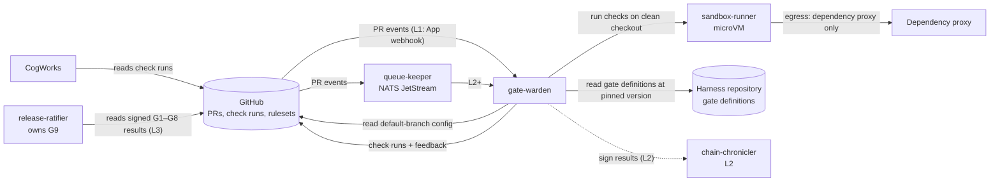

# Overview

## Purpose

gate-warden decides pass or fail. It re-runs every gate it owns from a **commit SHA**, in a
**clean sandbox**, under **its own GitHub App**, and publishes the results as GitHub check runs.
It is the only App configured as the source of required checks, so no agent can forge a green
status. From L2 it also verifies that human-only transitions were made by authorised humans.

This fills the "no process referee" gap. See handbook ADR-0004, *gate-warden is the only source
of pass/fail verdicts*
([brightsmiths/handbook](https://github.com/brightsmiths/handbook), `docs/adr/`).

## System context

Brightsmiths takes engineering work from a GitHub issue to a published GitHub Release. Its core
rule is that an LLM is a component inside a deterministic machine, never the machine itself.
gate-warden is one of the deterministic parts. It never uses an LLM to decide pass or fail.

gate-warden never calls another service to hand over work, and no service calls gate-warden to
hand over work. It reacts to GitHub events and writes GitHub state: check runs and, from L2,
baseline files. CogWorks and others read that state.

## Where gate-warden sits in the workflow

The handbook's workflow (`docs/architecture/workflow.md`) defines gates G1–G9 and human
touchpoints H1–H7. gate-warden owns the G-gates **G1–G8**. **G9 (Release) is owned and published
by release-ratifier.** gate-warden supplies G9's inputs: the signed G1–G8 results for a SHA
([ADR-0011](../adr/ADR-0011-g9-owned-by-release-ratifier.md)).

This is a deliberate tension with "gate-warden is the only required-check source". How G9 is
enforced is decided in release-ratifier's spec. The options are a required check from a second
App, or release-ratifier refusing to tag or publish. See [gates.md](gates.md) and
[security.md](security.md).

## Scope by level

| Level | Milestone | Built by | Scope |
| --- | --- | --- | --- |
| **L1** | M1 | Humans | GitHub App intake for PR events. Config resolved from the default branch. Checks run in a sandbox-runner microVM. Standard gate result format and gate definition schema v1. One check run per gate (G6 Build). Coarse structured feedback. Ruleset guidance and read-only audit. Idempotency. |
| **L2** *(planned)* | M3 | Factory, with human review | Spec-PR gates G1, G3 and G4. Human-transition and approval verification. commit-gate, todo-gate and ratchet checks. Signed gate results through chain-chronicler L1. queue-keeper intake. Baseline writes. |
| **L3** *(planned)* | M6 | Factory, with human review | Tier thresholds. Holdouts. G5 and G8. G9 inputs for release-ratifier. |

gate-warden's factory role is complete at M6. Anything beyond L3 belongs to its own roadmap
and is marked "after factory role complete". This includes G2 and G7 (see [gates.md](gates.md)).

## Non-goals ("must not")

gate-warden must not:

1. Contain discipline-specific logic. Checks are commands that discipline packs supply.
2. Read gate config from the PR it judges.
3. Expose holdout content or test source in feedback.
4. Hold workflow state beyond GitHub check runs and baseline files.
5. Use an LLM to decide pass or fail. LLM reviewer findings (L3, G8) are inputs; the tier
   decides how severe a finding must be to block.

Also out of scope:

- Running G9 or publishing a G9 check run.
- Deployment and artifact registries.
- Merge queues (`merge_group` events) at L1.
- Isolation itself. sandbox-runner provides the microVM; gate-warden only requests it.

## Bootstrap (M1)

At M1 humans stand in for the services that do not exist yet:

- **Event routing:** queue-keeper routing is not required. gate-warden receives App webhooks
  directly.
- **Signing:** chain-chronicler does not exist yet, so L1 results are not signed.
- **Who opens PRs:** humans write and scope issues and start runs from the CLI. The pilot
  repository is commit-gate.
- **Rulesets:** configured by a human following [operations.md](operations.md#ruleset-setup).

## Related documents

- [vocabulary.md](vocabulary.md): domain terms
- [requirements.md](requirements.md): GW-REQ requirements
- [gates.md](gates.md): gate catalogue and ownership
- [architecture.md](architecture.md): boundaries and flows
